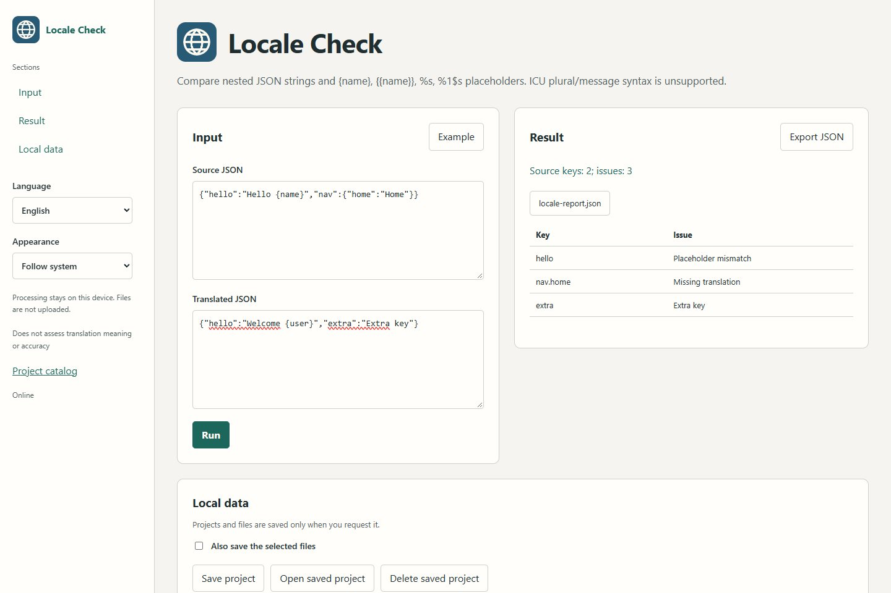

# Locale Check

[English](README.md) · [Russian](README.ru.md) · [Spanish](README.es.md)

Detecta claves de traducción ausentes y marcadores distintos en archivos JSON.

Autor: [d9911](https://github.com/d9911).

Ejecutar

Windows: `Start.cmd`

macOS / Linux: `sh start.sh`

[Abrir la aplicación](http://127.0.0.1:8835/).

